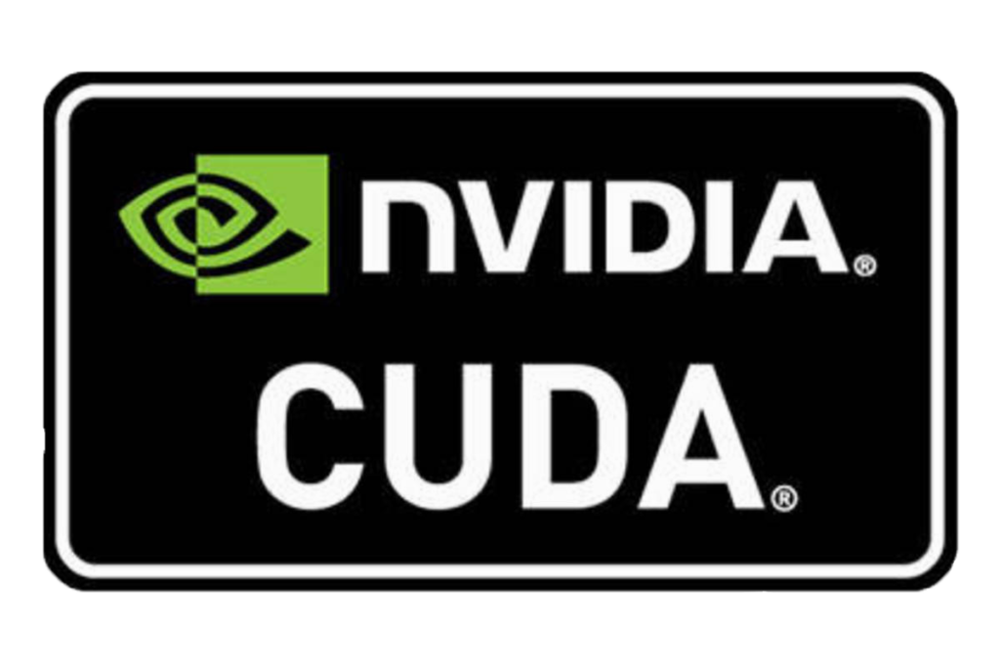
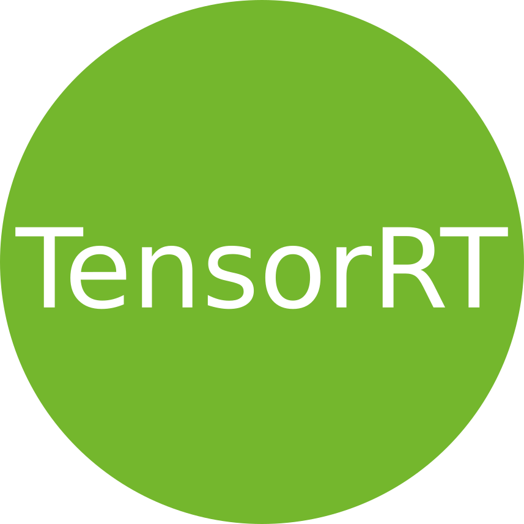

## About Me
I'm Dimitrios Fotiou, a **Computer Vision Engineer** based in Thessaloniki, Greece, with an Integrated Master's in Electrical and Computer Engineering (AUTh, with distinction, **GPA 8.99/10**). I have 3 years of industry and research experience shipping deep learning models to production for industrial defect inspection and multi-sensor perception (RGB, thermal, LiDAR).  
Currently at **[D-Cube](https://www.d-cube.eu/)**, I build anomaly detection models for aluminum profile inspection. They run in production at several of Europe's largest aluminum producers. Previously, I was a researcher at **[AIIA.CVML](https://aiia.csd.auth.gr/computer-vision-machine-learning/)**, where I worked on real-time wildfire segmentation from RGB and thermal imagery. During my studies, I developed perception and localization for **Greece's first autonomous Formula Student race car** with [ARISTURTLE](https://www.aristurtle.gr/).  
Focus areas: defect/anomaly detection, segmentation, 3D vision and 6D pose estimation, test-time adaptation, and efficient inference (TensorRT, CUDA, quantization).

## Skills and Technologies
### 🛠️ Technologies

&nbsp;
&nbsp;
&nbsp;
&nbsp;
&nbsp;
&nbsp;
&nbsp;
&nbsp;
&nbsp;

### 👨‍💻 Languages

&nbsp;
&nbsp;
&nbsp;
&nbsp;
&nbsp;

### 💻 OS

&nbsp;
&nbsp;
&nbsp;
&nbsp;

## Milestones
- **2025 (Sep) - Now:** Computer Vision Engineer at [D-Cube](https://www.d-cube.eu/). Building AI-based visual inspection for aluminum extrusion, deployed at several of Europe's largest aluminum producers.
- **2026:** Published [RoboFireFuseNet](https://doi.org/10.1016/j.patrec.2026.04.024) in *Pattern Recognition Letters* and [TestMate](https://arxiv.org/abs/2607.03810) on arXiv.
- **2024 (Aug) - 2025 (Sep):** Computer vision researcher at [AIIA.CVML](https://aiia.csd.auth.gr/computer-vision-machine-learning/) and programmer at [TEMA-project](https://tema-project.eu/). Teaching assistant for the MSc course *Autonomous System Perception* and lecturer on *Wildfire Image Analysis* at AIDA Summer School 2025.
- **2023 (Oct) - 2024 (July):** Served as a Programmer and Network Security Analyst for the Greek Army.
- **2023 (June):** Completed Master's degree with distinction from the Polytechnic School in Electrical and Computer Engineering, specializing in Computers and Electronics.
- **2022 (Sept) - 2023 (June):** Completed Diploma [Thesis](https://drive.google.com/file/d/1bU3LGlbmP9Ni8-itYjfeBEJv9t3pE1vR/view?pli=1) on LiDAR-assisted Indoor Environment Replication and Human Detection under the supervision of [Prof. George Karagiannidis](https://scholar.google.com/citations?user=7FZ1r94AAAAJ).
- **2022 (March) - 2022 (Sept):** Internship at Information Technologies Institute [ITI](https://www.iti.gr/iti/en/home/), specializing in LiDAR-based Loop Closure Detection for autonomous cars.
- **2020 - 2021:** Computer Vision & Sensor Fusion programmer at [ARISTURTLE](https://www.aristurtle.gr/) for Greece's first Formula Student autonomous vehicle, [Thetis](https://www.aristurtle.gr/thetisdv/). Achieved 3rd place in Skidpad and 4th in Dynamic Events at Hungaroring.

## Contact Information

